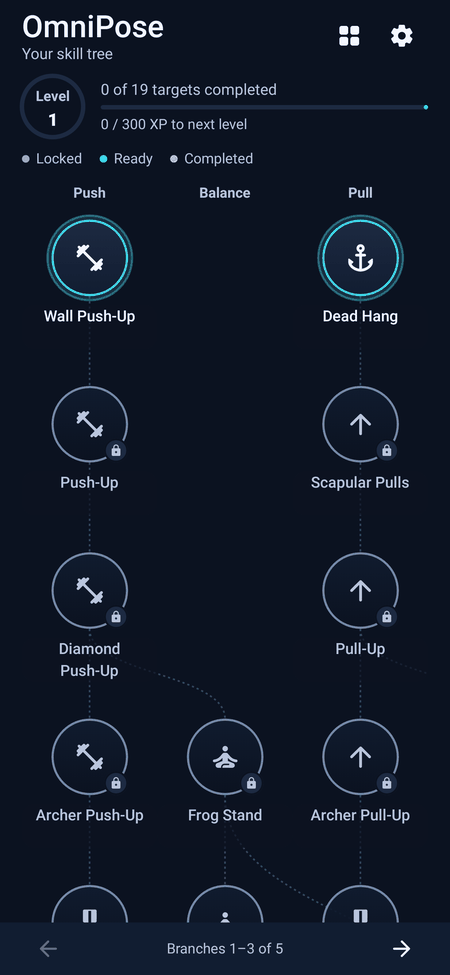
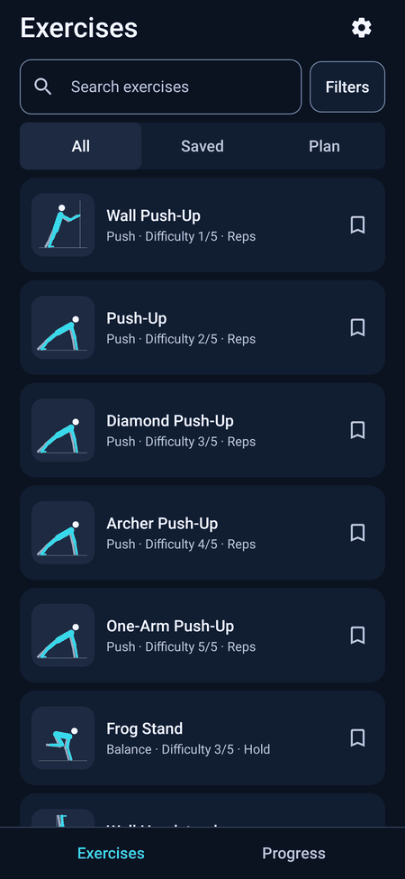
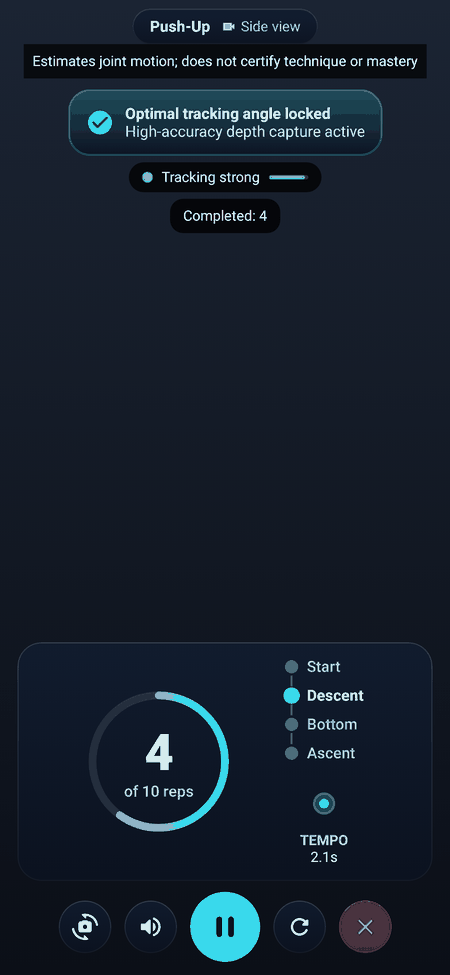
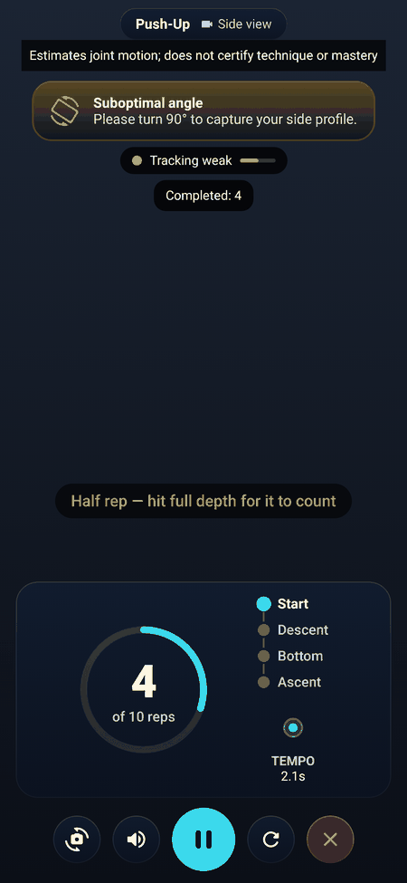
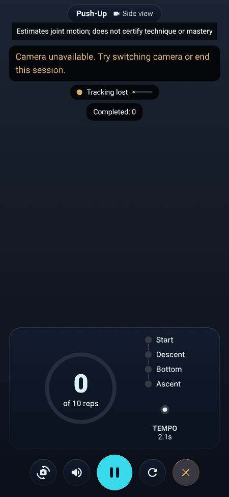
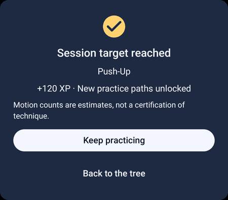
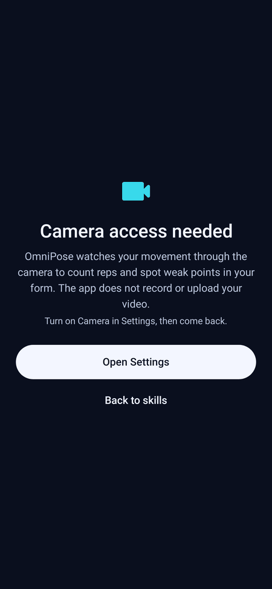
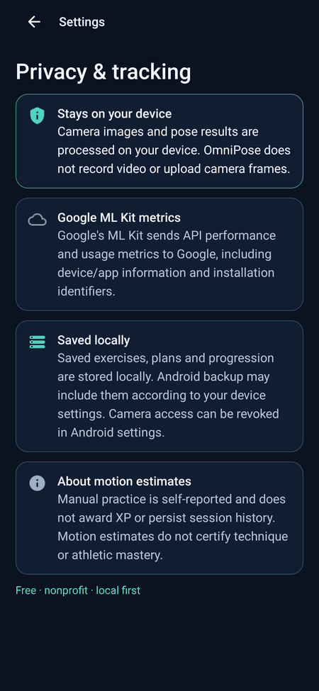

# OmniPose Fit

Android calisthenics practice app (prototype). It shows a skill-progression map and uses the camera with Google ML Kit pose detection to estimate joint angles and count repetitions or holds. Counts are estimates: tracking accuracy has not been validated on physical devices, and the app gives no form assessment, coaching, or medical advice.

This repository hosts release binaries and documentation only; the source repository is not publicly linked here.

## Download

**Latest version: v1.5.0** · [Always get the newest release](https://github.com/grloper/OmniPose-Fit-releases/releases/latest) · [All releases](https://github.com/grloper/OmniPose-Fit-releases/releases)

| File | Use for | Size | SHA-256 |
|------|---------|------|---------|
| [`OmniPoseFit-arm64-v8a.apk`](https://github.com/grloper/OmniPose-Fit-releases/releases/download/v1.5.0/OmniPoseFit-arm64-v8a.apk) | Almost all modern phones (recommended) | 55.6 MiB | `62569bd2b15d1c81574c889aad041522d5cf68a5a498a676c364be001e13ff2a` |
| [`OmniPoseFit-armeabi-v7a.apk`](https://github.com/grloper/OmniPose-Fit-releases/releases/download/v1.5.0/OmniPoseFit-armeabi-v7a.apk) | Older 32-bit ARM phones | 50.3 MiB | `5a1d228cd2d184be5faff05f63f27498d6a26d75b85e698b03066bb5d04486e1` |
| [`OmniPoseFit-x86_64.apk`](https://github.com/grloper/OmniPose-Fit-releases/releases/download/v1.5.0/OmniPoseFit-x86_64.apk) | x86_64 emulators / some Chromebooks | 53.9 MiB | `3a9b56ab80231a4dd77f40d70d61449252eb758a2aed8c2b6e05fab4c4519fa3` |
| [`OmniPoseFit-universal.apk`](https://github.com/grloper/OmniPose-Fit-releases/releases/download/v1.5.0/OmniPoseFit-universal.apk) | Any of the above (larger download) | 109.0 MiB | `1d13ecd706b16a9b3723213ba455ebd8ca3cf78975f8df7a6a7bfcafb6b422c5` |

A [`SHA256SUMS.txt`](https://github.com/grloper/OmniPose-Fit-releases/releases/download/v1.5.0/SHA256SUMS.txt) file is attached to the release. The checksums above were computed from the v1.5.0 release assets. If this table is behind, the [latest release](https://github.com/grloper/OmniPose-Fit-releases/releases/latest) page is authoritative.

> **Debug-signed builds.** These APKs are signed with an Android *debug* certificate (SHA-256 `37c2a6c2a16d67a5943d8b5d3bef7012d51b26984b38dadd58f66071f8208c53`), not a release key. They are not Play Store builds. Android only upgrades an installed copy with an APK signed by the same certificate, and debug certificates are not under strong key management, so only install builds from this repository after checking the hash.

### Which file do I pick?

- Most phones from the last several years: **arm64-v8a**.
- Not sure: **universal** works everywhere but is about twice the size.
- On the phone, *Settings → About phone* or an app such as "CPU-Z" shows the architecture (`arm64-v8a`, `armeabi-v7a`, `x86_64`).
- Each APK is 50–110 MB because the ML Kit pose model's native libraries are bundled.

## Install

1. Download the APK for your device (see above) on your Android phone.
2. [Verify the SHA-256](#verify-the-download) (recommended).
3. Open the file. If Android asks, allow your browser or file manager to **install unknown apps** (Settings → Apps → Special access → Install unknown apps).
4. If Play Protect shows a warning for an app it has not seen, choose *Install anyway* if you trust this repository.
5. Open OmniPose Fit and grant the **camera** permission on first launch.

Requires Android 7.0 (API 24) or newer and a camera.

## Verify the download

Compare the hash to the table above or to `SHA256SUMS.txt`.

**Windows (PowerShell):**

```powershell
Get-FileHash .\OmniPoseFit-arm64-v8a.apk -Algorithm SHA256
```

**Linux / macOS:**

```sh
sha256sum OmniPoseFit-arm64-v8a.apk        # macOS: shasum -a 256 OmniPoseFit-arm64-v8a.apk
sha256sum -c --ignore-missing SHA256SUMS.txt   # checks every file you downloaded
```

The values must match exactly. If they do not, delete the file and download it again.

## Troubleshooting

- **"App not installed" / signature conflict:** an existing copy of the app was signed with a different certificate (for example a locally built debug version). Uninstall it first, but note that this deletes the app's local progress. Android will not let a different signer overwrite an installed app.
- **"Parse error" / "There was a problem parsing the package" / app crashes at start:** usually the wrong ABI or a damaged download. Re-download, check the hash, or use the universal APK. Android 6.0 and older is not supported.
- **Install blocked:** enable *Install unknown apps* for the app you opened the file with.
- **Camera does not start:** grant the camera permission in *Settings → Apps → OmniPose Fit → Permissions*.
- **Not enough storage:** allow roughly 2× the APK size free during install.

## Known limitations

- Prototype. Repetition counting uses 2D pose landmarks and simple angle rules; accuracy depends on lighting, framing and camera angle, and is unverified on real exercise sessions.
- Only some skills have camera tracking; the others use manual practice. Variant skills that share a generic schema cannot unlock progression automatically.
- Preview clips are illustrations, not recordings of the app.
- Builds are debug-signed and not reproducible; see the warning above.
- v1.0.0–v1.4.0 were published with identical internal version numbers (versionCode 1), so Android cannot order them; v1.5.0 (versionCode 10500) and later use a monotonic versionCode.
- v1.5.0 was signed with a different debug certificate than v1.0.0–v1.4.0 (see the warning above), so it cannot be installed over those versions: uninstall the old copy first (this deletes local progress).
- v1.5.0 has not been verified on a physical phone or camera.

## Screenshots

| Progress map | Exercise library | Live HUD – tracking strong | Live HUD – weak angle / half rep |
|---|---|---|---|
|  |  |  |  |

| Live HUD – tracking lost / camera error | Session summary | Camera permission rationale | Settings & privacy |
|---|---|---|---|
|  |  |  |  |

_v1.5.0 screenshots. These images are **rendered on the JVM** (Robolectric + Roborazzi, deterministic sample data, synthetic backdrop instead of a camera feed) — they are **not device captures** and do not demonstrate real pose-detection accuracy._

## Privacy

See the [privacy note](PRIVACY_POLICY.md). In short: no account, ads or developer-run server; camera frames are processed on-device; the app declares the `INTERNET` permission through the bundled Google ML Kit SDK, which may contact Google for model/compatibility checks and usage metrics, so the app is not guaranteed to be offline.

## Feedback

Please [open an issue](https://github.com/grloper/OmniPose-Fit-releases/issues) for bugs, device compatibility reports or questions. Include your phone model, Android version, the APK you installed and what happened.

## License

No license is granted for the OmniPose Fit app by this repository; all rights are reserved by the owner unless stated otherwise in a future release. This repository only hosts release binaries and documentation.
